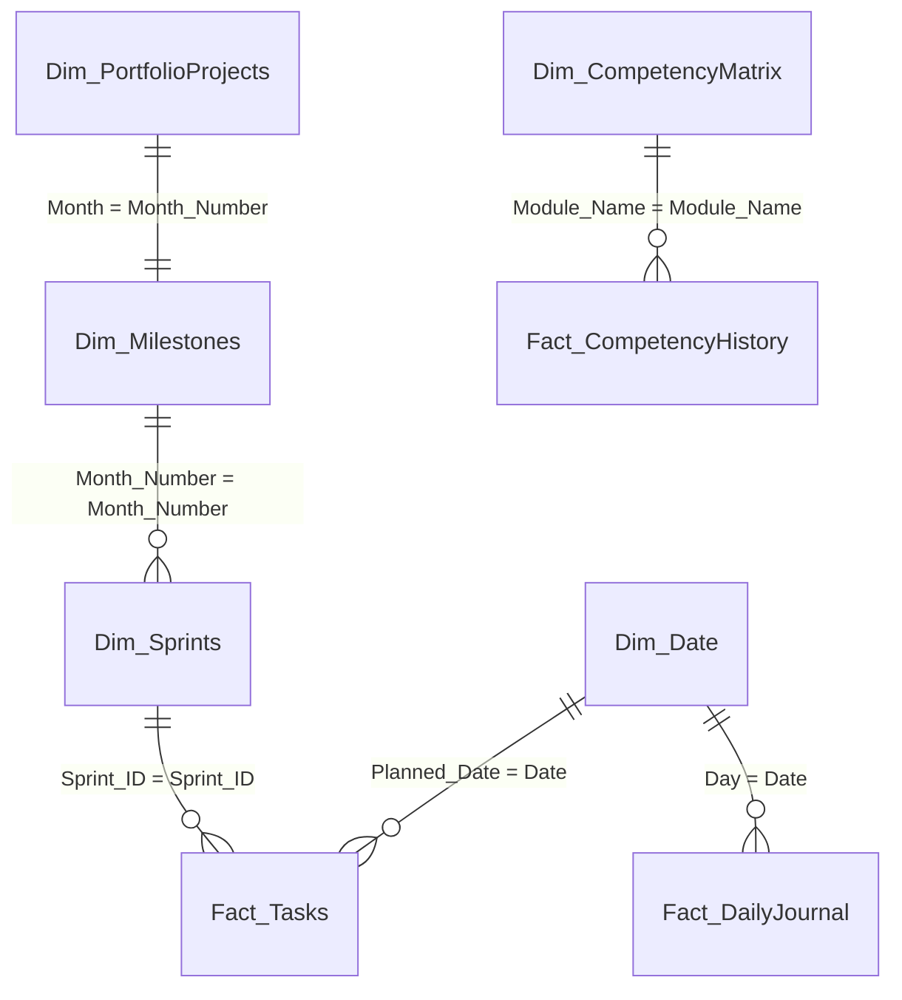

# Power BI Storytelling Dashboard — Phase 3A Architecture Guide

> **Project:** Mostafa Mohamed Practice Plan  
> **Target Role:** Business Intelligence / Data Analyst  
> **Design Language:** Microsoft Fluent Design (Dark Blue `#002050`, Primary Blue `#0078D4`, White `#FFFFFF`)  
> **Source Datasets:** `D:\English\output\datasets\`  
> **Output Assets:** `D:\English\output\powerbi\`

---

## 1. Data Model (Star Schema)

The Power BI model is structured into clean **Fact** and **Dimension** tables with single-direction 1-to-many relationships:

### Table Inventory in `D:\English\output\datasets\`
1. **`schedule.xlsx`**:
   - `Fact_Tasks`: 953 rows (Daily actionable steps derived from the real Excel plan).
   - `Dim_Sprints`: 24 rows (Sprints with dates, goals, and status).
   - `Dim_Milestones`: 6 rows (Monthly milestones).
   - `Dim_Date`: 210 rows (Continuous calendar with week numbers and weekends).
2. **`skill_tracker.xlsx`**:
   - `Dim_CompetencyMatrix`: Modules, current levels, target levels, weights.
   - `Fact_CompetencyHistory`: Historical scoring trajectory.
3. **`progress_log.xlsx`**:
   - `Fact_DailyJournal`: 30 tracked days, vocabulary count, speaking minutes, reflection status.
4. **`career_and_portfolio.xlsx`**:
   - `Dim_PortfolioProjects`: 6 month-by-month portfolio deliverables.
   - `Fact_CareerTracking`: Job search funnel (LinkedIn, Applications, Interviews, Offers).
   - `Dim_GoogleCertificate`: 8 Google Data Analytics certificate courses.
   - `Dim_CareerRoadmap`: Past (ERP), Present (BI), and Future (AI).

---

## 2. Nine-Page Visual Layout & Storytelling Flow

```mermaid
flowchart LR
    P1["Page 1: Executive Overview"] --> P2["Page 2: Learning Journey"]
    P2 --> P3["Page 3: Sprint Engine"]
    P3 --> P4["Page 4: Competency Radar"]
    P4 --> P5["Page 5: English Immersion"]
    P5 --> P6["Page 6: Portfolio Projects"]
    P6 --> P7["Page 7: Career Funnel"]
    P7 --> P8["Page 8: Google Certificate"]
    P8 --> P9["Page 9: Future AI Horizon"]
```

---

### Page 1: Executive Overview — *"Where am I today?"*
* **Core Narrative:** A high-level briefing for Mostafa and stakeholders on real-time readiness and immediate priorities.
* **Key Visuals:**
  * **Hero KPI Card:** `Job Readiness Index` (Gauge chart with target 85+).
  * **Status Badge:** `Job Readiness Status` (e.g. "Core Skills Solid 📈").
  * **Sprint Context:** `Current Active Sprint` (Sprint 1) & `Current Milestone` (Month 1).
  * **Today's Action Items:** Table of `Fact_Tasks` filtered to `Planned_Date = TODAY()`.
  * **Burndown Mini-Chart:** Planned vs. Completed Hours over the 24 Sprints.

---

### Page 2: Learning Journey — *"How did Mostafa grow?"*
* **Core Narrative:** Demonstrating progression from ERP Technical Support background into a modern Data & BI Analyst.
* **Key Visuals:**
  * **Horizontal Timeline:** Milestones 1 through 6 with competency unlocks (SQL → Power BI → Python → Stats → English Storytelling).
  * **Cumulative Hours Area Chart:** Cumulative hours invested by domain over time.
  * **Key Highlights Matrix:** Shift from ERP operational support to data architecture & automated reporting.

---

### Page 3: Sprint Performance — *"Am I executing the plan?"*
* **Core Narrative:** Rigorous Agile tracking across all 24 sprints.
* **Key Visuals:**
  * **Sprint Matrix / Table:** Sprint #, Start/End Date, Goal, Tasks Count, Progress %, Status.
  * **Planned vs Actual Burndown:** Dual-line chart showing `Planned Cumulative Tasks` vs `Actual Cumulative Completed`.
  * **Task Distribution:** Donut chart of tasks by `Day_Type` (Session Days, Grammar & Vocab Days, Challenge Days).

---

### Page 4: Competency Radar — *"What am I good at? What is still weak?"*
* **Core Narrative:** Transparent skills evaluation showing progress toward the "Job Ready" bar.
* **Key Visuals:**
  * **Radar / Spider Chart or Grouped Bar:** Modules (SQL, Power BI, Python, Statistics, English, Agentic AI, Interview Skills) showing `Progress` vs `Target (90)`.
  * **Competency Gap Card:** `Competency Gap to Job Ready` highlighted in warning colors for weak areas.
  * **Historical Trajectory Line Chart:** Date on X-axis, Score on Y-axis, segmented by Module from `Fact_CompetencyHistory`.

---

### Page 5: English Progress — *"Is my English improving?"*
* **Core Narrative:** Direct evidence of daily language immersion sourced from `Mostafa Mohamed Practice Plan.xlsx`.
* **Key Visuals:**
  * **KPI Cards:** `Cumulative Vocabulary Learned` (words), `Total Speaking Minutes` (via ChatGPT recording & sessions), `Daily Adherence Rate %`.
  * **Journal Completion Heatmap:** Calendar view of days showing green (completed) vs gray (pending).
  * **Skill Area Task Breakdown:** Column chart of English tasks (Grammar: 181, Review: 306, Speaking: 129, Writing: 129, Vocab: 104, Listening: 52).

---

### Page 6: Portfolio Progress — *"What have I built?"*
* **Core Narrative:** Proof of capability through 6 tangible, end-to-end business projects.
* **Key Visuals:**
  * **Portfolio Showcase Cards:** 6 cards (Month 1 to Month 6) displaying Title, Domain, Tech Stack, and Business Impact.
  * **Status Slicer:** Filter by `Completed`, `In Progress`, `Planned`.
  * **Tech Stack Distribution:** Treemap showing tech representation (SQL Server, Power BI/DAX, Python/Pandas, Fastify, Agentic AI).

---

### Page 7: Career Dashboard — *"Am I moving toward a job?"*
* **Core Narrative:** Tracking commercial readiness and conversion metrics through the recruitment pipeline.
* **Key Visuals:**
  * **Funnel Chart:** Stages from LinkedIn Optimization → Applications Sent → Recruiter Screenings → Technical Interviews → Offers.
  * **Conversion Rate Cards:** `Interview Conversion Rate` and Application-to-Screening ratios.
  * **Activity Log:** Weekly applications and recruiter outreach pace.

---

### Page 8: Certificate Progress — *"Google Data Analytics Professional Certificate"*
* **Core Narrative:** Tracking progress on Google's industry-recognized supporting curriculum.
* **Key Visuals:**
  * **Overall Progress Gauge:** `Google Certificate Overall Progress %`.
  * **Course Milestone Grid:** 8 Courses listed with Completion %, Status, and Target Month.
  * **Status Slicer:** Supporting Track vs Primary Roadmap toggle.

---

### Page 9: Future Roadmap — *"What comes after employment?"*
* **Core Narrative:** Long-term professional growth and technological ambition.
* **Key Visuals:**
  * **Roadmap Matrix:** Next-horizon tracks: Deep Learning & Neural Networks (PyTorch), Computer Vision (OpenCV, YOLO), Transformers & Agentic AI Systems.
  * **Readiness Criteria:** Conditions required before triggering Phase 4 (e.g. 6 months in BI role).

---

## 3. Microsoft Fluent Design System Setup

1. Open **Power BI Desktop**.
2. Go to **View** ribbon → **Themes** dropdown → **Browse for themes**.
3. Select `D:\English\output\powerbi\fluent_dark_blue_theme.json`.
4. Import the four Excel files from `D:\English\output\datasets\` via **Get Data → Excel Workbook**.
5. Paste the DAX measures from `D:\English\output\powerbi\dax_measures_library.dax` into a dedicated `_Measures` table.
